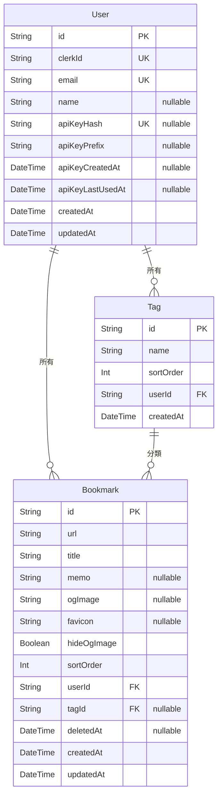

# Schema

スキーマ定義の**正は [`prisma/schema.prisma`](../prisma/schema.prisma)**。本ドキュメントはリレーションと各カラムの**意味**（コードだけでは読み取りにくい制約・用途）を補足する。

---

## リレーション図

---

## テーブル定義（概要）

### User

| カラム | 型 | 説明 |
|--------|-----|------|
| id | String (CUID) | 主キー |
| clerkId | String | ユニーク。Clerk ユーザー ID（初回ログイン時に同期） |
| email | String | ユニーク。メールアドレス |
| name | String? | 表示名（任意） |
| apiKeyHash | String? | 外部 REST API 用 API キーの SHA-256（hex・ソルト無し・ユニーク）。**平文は保存しない**（生値は発行直後に一度だけ返す）。未発行は null。ヘッダーのモーダルで生成・再生成 |
| apiKeyPrefix | String? | キーの先頭 8 文字（`lh_` + 5 文字）。どのキーかを識別する表示用。未発行は null |
| apiKeyCreatedAt | DateTime? | キーの発行日時（棚卸し用）。平文保存からの移行分は移行時刻 |
| apiKeyLastUsedAt | DateTime? | キーで最後に認証した日時（棚卸し用）。書き込み抑制のため前回更新から 1 時間以上経過時のみ更新するので、最大 1 時間古い。更新失敗は認証結果に影響させず握りつぶす（次回リクエストで再試行）ため、その場合はさらに古くなり得る |
| createdAt | DateTime | 作成日時 |
| updatedAt | DateTime | 更新日時 |

### Bookmark

| カラム | 型 | 説明 |
|--------|-----|------|
| id | String (CUID) | 主キー |
| url | String | ブックマーク URL（http/https のみ） |
| title | String | タイトル（必須、最大 200 文字） |
| memo | String? | メモ（任意、最大 1000 文字） |
| ogImage | String? | OGP 画像 URL（URL 入力時に自動取得、任意） |
| favicon | String? | ブックマーク先サイトのファビコン URL（保存時に自動取得、任意）。未取得・取得失敗は null。null の場合、一覧表示は Google のファビコンサービスにフォールバックする（取得の契約は `docs/architecture.md` 参照） |
| hideOgImage | Boolean | OGP 画像を一覧で非表示にするか（デフォルト false）。画像 URL は保持し表示のみ切り替える |
| sortOrder | Int | 表示順（デフォルト 0、D&D による並び替えで更新） |
| userId | String | 外部キー → User.id（User 削除時に CASCADE） |
| tagId | String? | 外部キー → Tag.id（Tag 削除時に SET NULL）。タグ分類用。null は「未分類」 |
| deletedAt | DateTime? | ソフトデリート日時。非 null は「ゴミ箱」。一覧取得は `deletedAt IS NULL` のみ対象 |
| createdAt | DateTime | 作成日時 |
| updatedAt | DateTime | 更新日時 |

### Tag

| カラム | 型 | 説明 |
|--------|-----|------|
| id | String (CUID) | 主キー |
| name | String | タグ名（ユーザー内でユニーク、最大 50 文字） |
| sortOrder | Int | 表示順（デフォルト 0、D&D による並び替えで更新） |
| userId | String | 外部キー → User.id（User 削除時に CASCADE） |
| createdAt | DateTime | 作成日時 |

---

## インデックス設計

| テーブル | インデックス | 用途 |
|----------|------------|------|
| users | `clerk_id` | Clerk ID による高速ルックアップ（UNIQUE） |
| users | `email` | メールアドレス重複防止（UNIQUE） |
| users | `api_key_hash` | API キー認証時のハッシュによる高速ルックアップ（UNIQUE） |
| bookmarks | `user_id` | ユーザー別ブックマーク取得の高速化 |
| bookmarks | `tag_id` | タグ別ブックマーク取得の高速化 |
| tags | `(user_id, name)` | ユーザー内タグ名のユニーク制約・高速ルックアップ |
| tags | `user_id` | ユーザー別タグ取得の高速化 |
